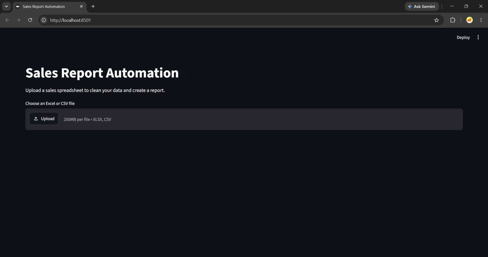

# Sales Report Automation

## Overview

Sales Report Automation is a Python project that cleans messy sales data and generates Excel reports. It is designed as a demonstration of spreadsheet automation for small businesses.

## Problem

Business spreadsheets can contain duplicate records, missing values, inconsistent dates, extra spaces, and invalid numeric values. Cleaning these manually takes time and can lead to mistakes.

## Features

- Generates 200 rows of fake sales data.
- Cleans dates, product names, and numeric columns.
- Removes duplicate records and rows with missing essential values.
- Calculates total sales for each order.
- Summarizes sales by product and month.
- Generates an Excel report with a bar chart.
- Provides a Streamlit interface for uploading Excel or CSV files.
- Allows users to preview cleaned data and download reports.
- Displays error messages for missing required columns.

## Technologies Used

- Python
- pandas
- openpyxl
- Streamlit
- matplotlib

## Project Structure

```text
01-sales-report-automation/
├── generate_sample_data.py
├── report.py
├── app.py
├── requirements.txt
├── README.md
├── sample_data/
│   └── sales_sample.xlsx
├── output/
│   └── sales_report.xlsx
└── screenshots/
    ├── input.png
    ├── output.png
    └── streamlit.png
```

## Setup

### 1. Create a virtual environment

```powershell
python -m venv .venv
```

### 2. Activate the environment on Windows

```powershell
.venv\Scripts\Activate.ps1
```

### 3. Install dependencies

```powershell
python -m pip install --upgrade pip
pip install -r requirements.txt
```

## How to Run

### Generate sample data

```powershell
python generate_sample_data.py
```

This creates `sample_data/sales_sample.xlsx` containing fake sales records.

### Generate the Excel report

```powershell
python report.py
```

The report is saved to `output/sales_report.xlsx`.

### Launch the web application

```powershell
python -m streamlit run app.py
```

Open the local URL displayed in the terminal, usually `http://localhost:8501`.

Upload an Excel or CSV file, review the cleaned data and summaries, and download the generated Excel report.

## Screenshots

Add screenshots of your application here after testing.

### 1. Sample Input Data



### 2. Cleaned Excel Output


### 3. Streamlit Web Application


## Limitations

- Input files must contain the required column names.
- Invalid dates and numeric values are treated as missing values.
- Rows missing essential fields are removed.
- This is a demonstration project using fake data, not a production financial reporting system.

## Data Privacy

The included sample dataset contains fake data. Do not commit confidential business spreadsheets, credentials, or personal information to the repository.

## Future Improvements

- Support configurable column mapping.
- Add more summary charts.
- Allow users to choose how missing values are handled.
- Add automated data validation and reporting.

## License

See the repository's LICENSE file for licensing information.
