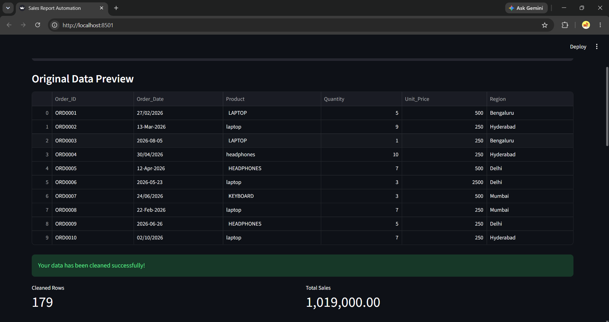

# Sales Report Automation

## Problem
Small businesses often keep sales data in messy Excel files, with inconsistent dates, duplicate rows and missing values. Turning that into a clean weekly report takes hours of manual work.

## What it does
- Cleans messy sales data: standardizes dates and text, removes duplicates and handles missing or invalid values
- Generates an Excel report with a cleaned data sheet, a summary by product and by month, and a chart
- Includes a Streamlit page where you upload a file, preview the result and download the report

## Input and output
**Input (messy file):**


**Output (cleaned report):**


**Streamlit app:**


## How to run
```bash
pip install -r requirements.txt
python generate_sample_data.py   # creates sample_data/sales_sample.xlsx (fake data)
python report.py                 # creates the cleaned Excel report
streamlit run app.py             # opens the web app
```

## Tech
Python, pandas, openpyxl, Streamlit

## Notes
All data in this project is fake and generated for demonstration. Real client files are never uploaded here.
